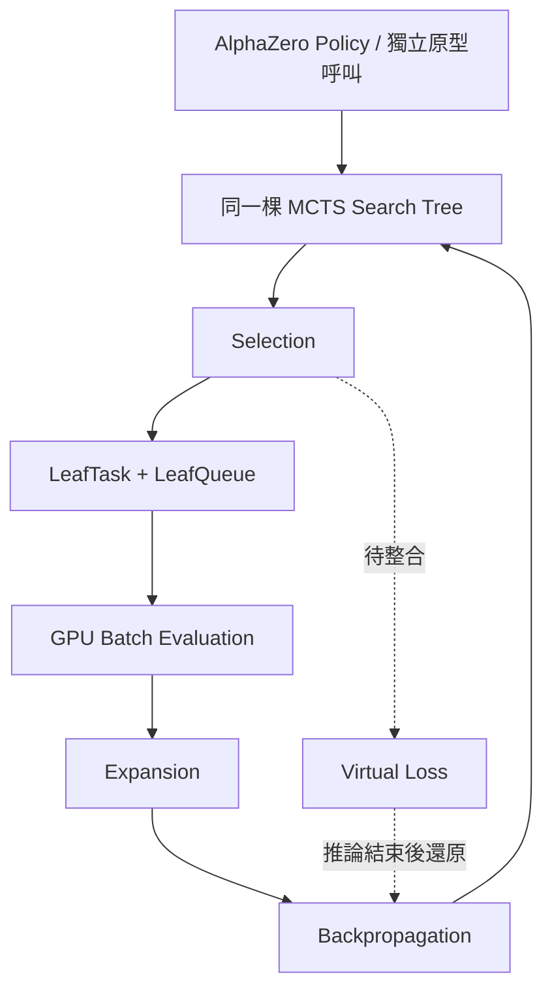

# GPU Batched MCTS 系統架構

> 進度更新：2026-10-21 初審討論版。本文件以 `batched-mcts` 開發分支與研究團隊執行紀錄為準；「原型成功」不代表已完成完整系統驗證或效能量測。

## 一、研究目標

以 LightZero 的 AlphaZero MCTS 為基礎，研究在**同一棵搜尋樹**中收集多個葉節點，透過 GPU 批次推論降低個別神經網路呼叫的開銷，並驗證搜尋正確性與效率差異。

## 二、原始系統

原始序列式 MCTS 每次模擬依序執行：

1. Selection：依 UCB 選擇搜尋路徑。
2. Evaluation：以神經網路評估葉節點。
3. Expansion：建立子節點。
4. Backpropagation：更新搜尋統計。

主要程式：`lzero/mcts/ptree/ptree_az.py`、`lzero/policy/alphazero.py`。

## 三、改良系統架構

**目前狀態：** `get_next_action_batched()` 已有可執行的多輪原型；但正式 AlphaZero Policy 的原有 `get_next_actions_batch()` 路徑尚未切換為新控制器，Virtual Loss 也尚未整合。原型以待處理節點 ID 集合避免同一批次重複選擇葉節點，不能等同於 Virtual Loss。

## 四、模組職責與完成狀態

| 模組 | 職責 | 截至 2026-10-21 狀態 |
| --- | --- | --- |
| MCTS Search Controller | 單樹 Selection、模擬迴圈、動作選擇 | 多輪原型已成功執行；正確性待擴充驗證 |
| LeafTask / LeafQueue | 保存 node、環境副本、搜尋路徑，收集批次 | 已合併並通過單元測試 |
| GPU Batch Evaluation | 同批評估多個 Connect4 葉節點 | RTX 5070 單輪與多輪原型已成功 |
| Expansion / Backpropagation | 將結果對應到各葉節點，回寫搜尋樹 | 單輪及多輪原型已成功；視角與終局待驗證 |
| Virtual Loss | 暫時調整路徑統計、評估後還原 | 尚未整合到 Controller |
| AlphaZero Policy 整合 | 讓正式 Policy 採用新控制器 | 尚未完成 |
| 效能 Benchmark | 比較序列式／批次式成本 | 尚未取得正式實驗數據 |

重要程式位置：

- `lzero/mcts/ptree/ptree_az.py`：`_select_leaf_for_batch()`、`_evaluate_queued_leaves()`、`get_next_action_batched()`。
- `lzero/mcts/ptree/leaf_queue.py`：`LeafTask`、`LeafQueue`。
- `experiments/connect4_gpu_batch_smoke.py`：真實 GPU 單輪批次測試。
- `tests/project/` 與 `lzero/mcts/tests/test_leaf_queue.py`：單元及介面測試。

## 五、已驗證的初步執行結果

執行平台：WSL2 Ubuntu / NVIDIA GeForce RTX 5070 12GB / PyTorch CUDA。

- 真實 Connect4 環境：從同一棵搜尋樹取出 4 個不同葉節點並加入 LeafQueue。
- 真實 GPU 單輪批次：Forward batch sizes 為 `[1, 4]`，根節點訪問次數為 `4`。
- 真實 GPU 多輪搜尋：12 次 Simulation，Batch Size 4，Forward batch sizes 為 `[1, 4, 4, 4]`；成功回傳合法動作及總和為 1 的動作機率。
- 研究團隊開發機回報：**15 項自動化測試通過**。

上述為**功能可行性證據**。模型尚未訓練，尚無可宣稱的加速倍率、棋力增益或搜尋品質結論。

## 六、尚待完成的技術問題

1. Virtual Loss 的路徑暫時統計與可逆還原；異常發生時也必須恢復。
2. Terminal／Draw、非空盤面、不同玩家視角的 Value 正負號及搜尋模擬次數一致性。
3. GPU 推論失敗、結果數量不符時的 Queue 任務與待處理狀態復原。
4. `get_next_action_batched()` 與正式 AlphaZero Policy 的介面整合。
5. 深度複製遊戲環境的 CPU 成本、真實吞吐量及加速效益量測。

## 七、預計實驗

先以 Batch Size **1、4、8、16** 進行框架驗證；待正確性及記憶體容量確認後，再評估擴大至 **32、64、128** 的可行性。

比較指標：每次搜尋總時間、每秒 Simulation／葉節點評估數、GPU Forward 次數與耗時、GPU 記憶體用量、搜尋正確性與輸出差異。正式效能比較須採同模型、同盤面、同模擬數，包含暖機及重複量測。

## 八、近期時程

- **2026-10-21**：初審說明；展示已驗證的多輪批次搜尋原型。
- **2026-10-22～24**：補強終局、部分 Batch、不同盤面與搜尋正確性。
- **2026-10-22～25**：完成 Virtual Loss 模組與單元測試，準備 PR。
- **2026-10-25～27**：MCTS × Virtual Loss、正式 Policy 整合驗證。
- **2026-10-28**：初步序列式／批次式效能比較。
- **2026-10-29～30**：整理程式、實驗紀錄、架構及框架交付文件。
- **2026-12**：完整效能實驗與研究報告。
