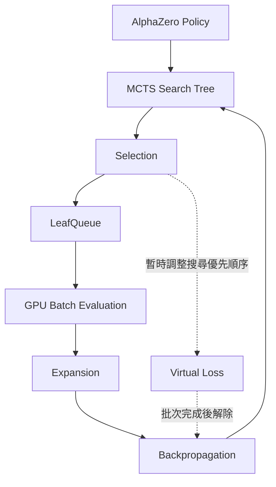

# GPU Batched MCTS 系統架構

## 一、研究目標

以 LightZero 的 AlphaZero MCTS 為基礎，
研究在同一棵搜尋樹中收集多個葉節點，
透過 GPU 批次推論提升搜尋效率。

## 二、原始系統

原始 MCTS 每次模擬依序執行：

1. Selection：依 UCB 選擇搜尋路徑
2. Evaluation：使用神經網路評估葉節點
3. Expansion：建立新子節點
4. Backpropagation：更新搜尋樹統計

主要程式：
- lzero/mcts/ptree/ptree_az.py
- lzero/policy/alphazero.py

## 三、預計改良架構

## 四、模組職責

### 1. MCTS Search
負責建立搜尋樹、選擇節點與控制模擬次數。

### 2. LeafQueue
收集同一棵搜尋樹內等待評估的葉節點，
並保存對應的節點、模擬環境狀態及回傳資訊。

### 3. GPU Batch Evaluation
沿用 AlphaZero Policy 的 _policy_value_fn_batch()，
將多個局面合併為一個神經網路推論批次。

### 4. Virtual Loss
在葉節點等待評估期間，暫時調整搜尋優先順序，
減少重複選取相同路徑的情況；
完成後解除暫時狀態。

### 5. Backpropagation
將各葉節點的評估結果回傳至正確搜尋路徑，
保持原有的玩家視角與價值正負號規則。

## 五、預定實驗

比較 Batch Size：
1、16、32、64、128。

預定指標：
- MCTS 搜尋時間
- 每秒評估節點數
- 神經網路推論次數與耗時
- GPU 使用狀況
- 搜尋正確性與結果品質

## 六、目前完成狀態

已完成：
- WSL2 + RTX 5070 CUDA 環境
- LightZero 安裝
- AlphaZero Connect4 功能測試
- 序列式相容介面及 GitHub 基準分支

尚未完成：
- LeafQueue 實作
- Virtual Loss 實作
- 單棵搜尋樹內的 GPU 批次評估
- 正式效能實驗
